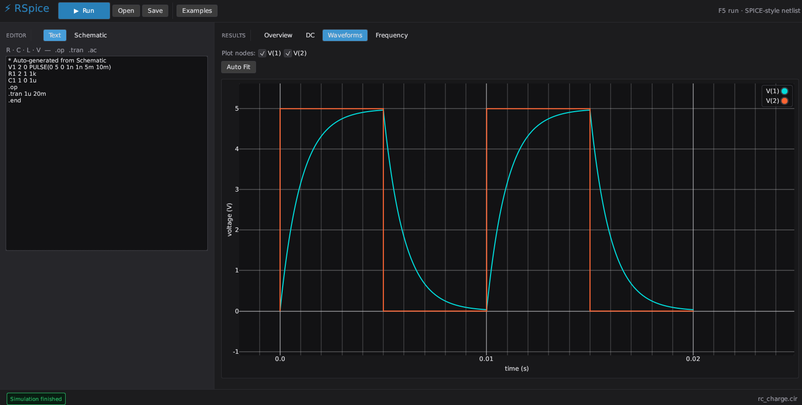
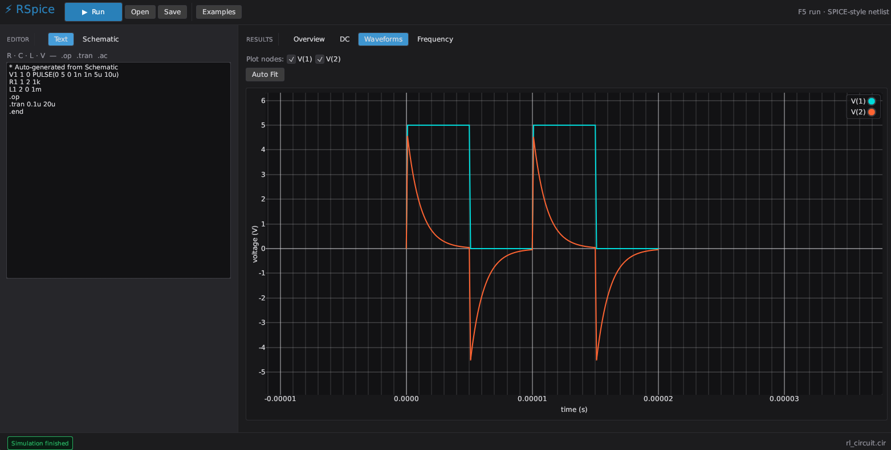
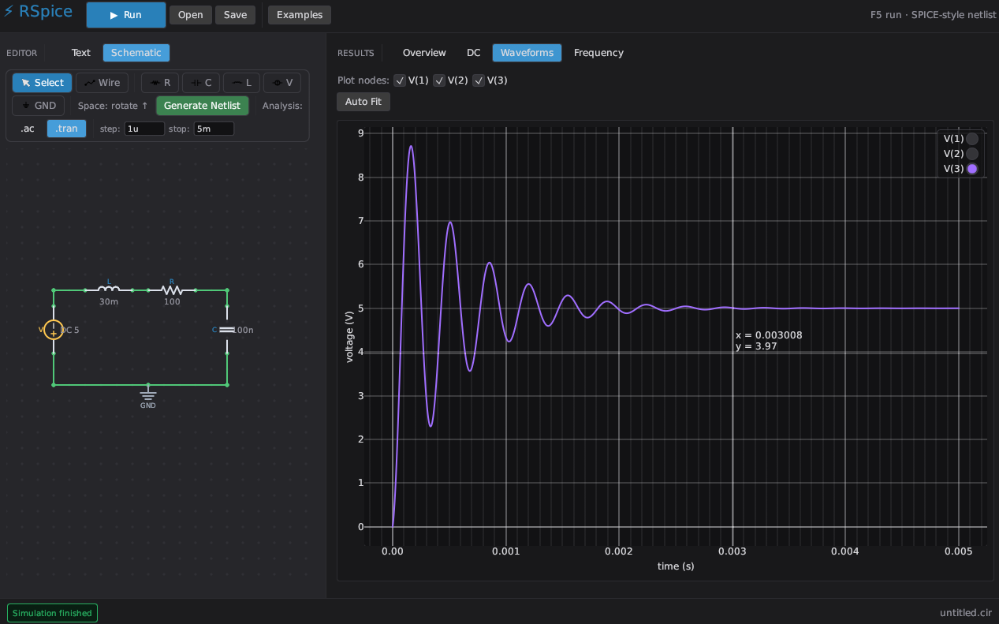

# RSpice

Analog circuit simulator in Rust, built to close the gap to LTspice and PSpice. It uses
**modified nodal analysis (MNA)** with Newton–Raphson to solve circuits with:

- **R** — resistors
- **C** — capacitors (transient, backward Euler)
- **L** — inductors (transient, backward Euler)
- **V** — voltage sources (DC, `AC`, `PULSE`, `SIN`, `EXP`, `PWL` incl. `PWL FILE`
  and `REPEAT`, `SFFM`, `AM`)
- **I** — independent current sources (same waveform grammar as `V`)
- **E/F/G/H** — voltage/current-controlled sources, including `POLY(n)`
- **S/W** — voltage- and current-controlled switches with `SW(RON ROFF VT VH)` models
- **K** — mutual inductance (`M = k√(L1·L2)`), i.e. ideal transformer coupling
- **D** — diodes (`.model D` with the full card: `IS`, `N`, `RS`, `CJO`, `VJ`, `M`,
  `TT`, `EG`, `XTI`, `BV`, `IBV`, `KF`, `AF`)
- **M** — MOSFETs (`.model NMOS/PMOS`, level-1 Shichman–Hodges, temperature drift)

## Screenshots
### RC circuit

### RL circuit

### Underdamped RLC circuit


## Quick start

To try it in your browser, visit https://rspice-web.vercel.app/

Alternatively, compile and run on your desktop:

```bash
git clone https://github.com/siamsamix/RSpice.git
cd RSpice
cargo run --release -p rspice    # graphical app
```

### GUI (`circuitsim-gui`)

Desktop app built with **egui** — dark theme, netlist editor, schematic view, DC tables and
sweep plots, and interactive waveform plots.

- **Run** or **F5** — simulate the current netlist
- **Examples** — load RC, voltage divider, RL, or RC low-pass circuits
- **Open / Save** — netlist files (`.cir`)
- Tabs: **Overview**, **DC** (operating point + `.dc` sweep plot/table),
  **Waveforms**, **Frequency response**

## Netlist format

SPICE-style text netlists:

| Element | Syntax | Example |
|---------|--------|---------|
| Resistor | `Rname n+ n- value` | `R1 in out 1k` |
| Capacitor | `Cname n+ n- value` | `C1 2 0 1u` |
| Inductor | `Lname n+ n- value` | `L1 2 0 1m` |
| Voltage source | `Vname n+ n- value [DC v] [AC mag [phase]] [PULSE(..)\|SIN(..)]` | `V1 1 0 DC 5` |
| Current source | `Iname n+ n- value [DC a] [AC a [ph]] [PULSE(..)\|SIN(..)]` | `I1 0 1 DC 1m` |
| Diode | `Dname n+ n- model` | `D1 1 2 Dmod` |
| MOSFET | `Mname d g s b model` | `M1 3 2 1 0 nmod` |

**Nodes** — `0` is ground (node `0` and `gnd` mean the same net). Nodes can also be named
alphanumerically (`in`, `out`), always case-insensitive; a named node never shares an id with a
numeric one (numeric nodes keep their number).

**Values** — SI suffixes `t g k m u n p f`, plus `MEG` (1e6) and `MIL` (25.4e-6), so `4.7Meg`
is 4.7 MΩ. Trailing unit letters are ignored (`5V`, `2Hz`).

**Comments & continuation** — `*` starts a comment only as the first character of a line; `;`
comments out the rest of a line (`V1 1 0 DC 5 ; drive rc`); a leading `+` continues the previous
line (`R1 in 2` then `+ 2k`), as real-world `.lib`/netlist files expect. End the deck with `.end`.

### Parameter language

```text
.param r1=2k gain = -3 label="five; six"     (numbers or strings, several per card)
V1 in 0 {1.5 + gain*0.1}                     (arithmetic inside braces)
R1 in out {r1}                               ({expr} evaluates against the param table)
Rf out gnd '2k*(1+gain/100)'                 (single quotes also trigger evaluation)
.func scaled(x) { x + gain*100 }             (user functions; bodies stay unevaluated)
Rg out gnd {scaled(1k)}                      (call site)
.dc gain -3 3 1                              (sweep a parameter like a source)
```

`.param` values read in deck order (reference before use) and are case-insensitive. `.func`
bodies may call the built-in library: `sqrt exp ln log log10 log2 sin cos tan asin acos atan
atan2 pow pwr hypot min max mod abs int floor ceil round sign sinh cosh tanh`.

### Devices and analyses

| Directive | Meaning |
|-----------|---------|
| `.op` | DC operating point (L shorts, C opens) |
| `.dc src start stop step` | sweep a `V`/`I` source or a `.param` (start/stop/increment) |
| `.dc src LIST v1 v2 …` | sweep over explicit values |
| `.dc V1 0 5 1 I1 0 1m` | nested second sweep — the second target steps inside the first |
| `.tran <tstep> <tstop> [tstart [tmax]] [UIC]` | adaptive transient; `tstep` is the print interval, not the stepped internals |
| `.ac DEC\|OCT\|LIN <points> <fstart> <fstop> [src_idx]` | small-signal frequency sweep |
| `.tf V(out) V1` / `.tf I(V1) V2` | DC transfer function and driving-point/output impedance |
| `.noise V(out) V1 DEC <points> <fstart> <fstop>` | output- and input-referred noise density and RMS |
| `.four <freq> <output…>` | Fourier decomposition of the last transient period |
| `.step [DEC\|OCT\|LIN] PARAM <name> <values>` | nested parametric runs (also `.step temp`) |
| `.meas <analysis> <name> avg\|rms\|max\|min\|pp\|max_at\|min_at\|find\|cross\|trig …` | measurement directives |
| `.temp <t…>` | simulation temperature (several values step the run temperature) |
| `.options method=trap\|gear2\|gear1 reltol=… abstol=… vntol=… maxstep=…` | integrator and tolerance controls |
| `.model name D(…)/NMOS(…)/PMOS(…)/SW(…)/R(…)/C(…)/L(…)` | device and passive model cards |

`.dc` accepts at most two nested sweeps and at most ~10⁶ points total; arguments that violate
that (bad count, zero or negative increment, empty LIST) are errors, never ignored.

## Example

```
* RC charging
.param r=2k
V1 in 0 DC 5 ; drive node "in"
R1 in 2 {r}
C1 2 0 1u
.tran 10u 5m
.end
```

CLI: the summary and tables print named nodes; waveform CSV keeps the deck's node names.

Export a waveform as CSV:

```bash
cargo run --release -- examples/rc_charge.cir --csv > rc.csv
```

`--csv` prints the `.tran` waveform or, when no `.tran` directive exists, the `.dc` sweep
(one column per swept target, then node voltages).

## Project layout

```
circuitsim/       Core library (parser + parameter language, MNA, analyses)
circuitsim-cli/   Command-line runner
circuitsim-gui/   egui desktop application
examples/         Sample netlists
```

## Model libraries

`libs/` ships generic device cards (`standard.lib`: diodes, level-1 MOSFETs, switches,
passive models, divider/low-pass subcircuits) and op-amp macromodels (`opamps.lib`), plus a
PSpice-style `nom.lib` master file. The CLI searches the deck directory, every `-I`/`RSPICE_LIB`
directory, and the bundled `libs/` tree, so `.include standard.lib` works from any directory.

## Regression corpus and benchmarks

- `examples/*.cir` is the fixture manifest, exercised by `circuitsim/tests/regression.rs`
  alongside analytic golden checks (RC/RL steps, RLC resonance, Shockley diode curve, CMOS
  inverter, bundled op-amp gain).
- `cargo run -p circuitsim --example benchmark` times a canonical suite and reports
  node·timesteps/s plus accuracy against the analytic RC step (`--json` for tooling).

## Limitations (v0.3)

Known gaps toward the LTspice/PSpice parity baseline (tracked in `TODO.md`):

- The linear solver is still dense `nalgebra` LU; sparse/Markowitz factorization,
  factor reuse, and threaded sweeps are open P1 items (the benchmark shows the cost)
- MOSFETs are level-1 with overlap and zero-bias junction capacitances (bias-dependent junction
  charge is still simplified); diode `RS`/`CJO`/`TT`/breakdown are stamped
- No BJT, JFET, transmission line, behavioral `B` source, or PSpice ABM extensions yet
- The GUI has symbols for `R C L V` and ground only; waveform cursors, trace arithmetic, FFT,
  raw-file I/O, and cross-probing are open
- `.tran` startup suppression of sources, and the full `.options` surface, are still open

## License

MIT
